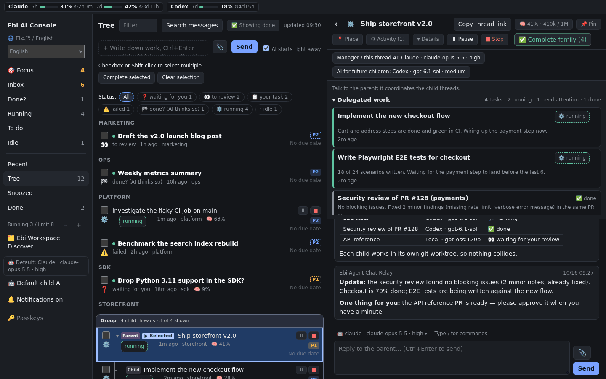
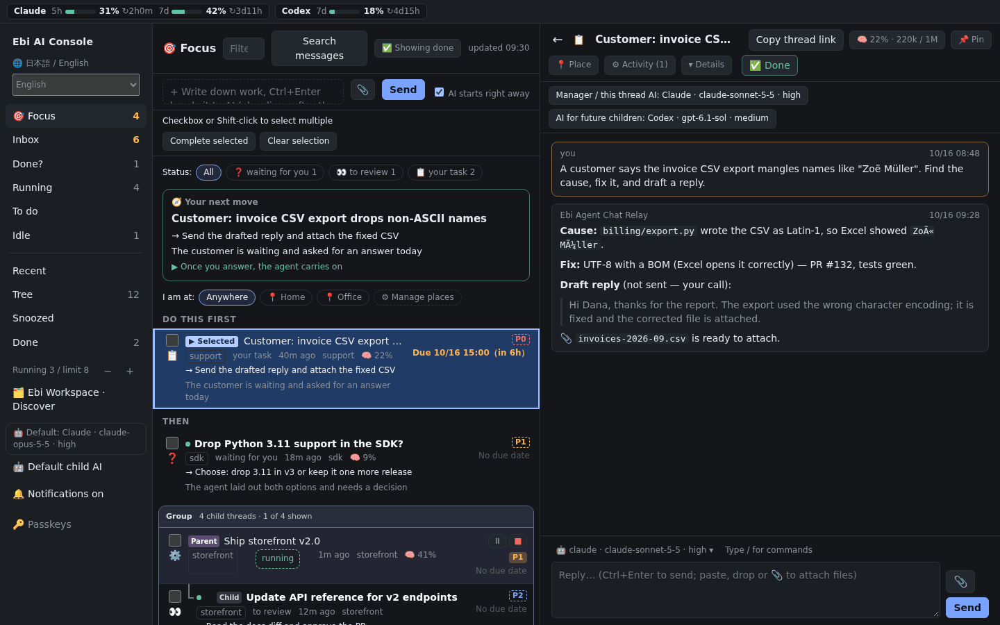
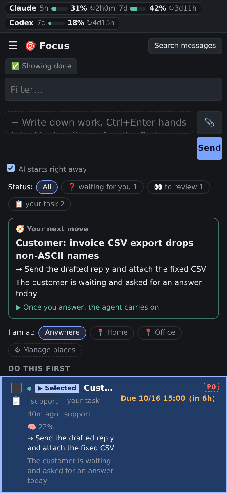

> **Note:** This is an auto-translated version of the original English documentation.
> If there are any discrepancies, the [English version](../../README.md) takes precedence.
> **注意:** これは英語のオリジナルドキュメントを自動翻訳したものです。
> 内容に相違がある場合は、[英語版](../../README.md)が優先されます。

# Ebi Agent Chat Relay

[](https://github.com/ebibibi/ebi-agent-chat-relay/actions/workflows/ci.yml)
[](https://github.com/ebibibi/ebi-agent-chat-relay/actions/workflows/codeql.yml)
[](https://www.python.org/downloads/)
[](https://github.com/ebibibi/ebi-agent-chat-relay/stargazers)
[](https://opensource.org/licenses/MIT)

**すべてのコーディングエージェントを、ひとつのコックピットから。** Claude Code・OpenAI Codex・
ローカルモデル・pi・AG-UI エージェントを並べて動かせます。話しかける場所も自由です。デスクトップでも
スマートフォンでも使える専用の Web コンソール（Entra ID サインイン対応）、Discord、Microsoft Teams のどれからでも。賢いモデルに指揮を任せ、手を動かす
作業は安いモデルに振り、人間は本当に自分が決めるべきところだけ判断します。



<sub>この README のスクリーンショットはすべて架空のサンプルデータです。
[`scripts/readme_screenshots.cjs`](../../scripts/readme_screenshots.cjs) で再生成できます。</sub>

## 選ばれる理由

| | |
|---|---|
| 🖥️ **エージェントを監督するための GUI** | Ebi AI Console は全エージェントのスレッドを 1 画面に並べ、「いま誰のボールか」で仕分けます。次にやることを示し、返信・ファイル添付・モデル切り替え・一時停止・停止までターミナルを開かずにできます。 |
| 📱 **マルチフロントエンド** | Discord、Microsoft Teams、専用の Web コンソール。どれか 1 つでも、1 つのプロセスで全部同時にでも使えます。組織の Teams テナントにエージェントを招き入れ、コンソールには Entra ID・Google・任意の OIDC プロバイダー・パスキーでサインインできます。 |
| 🔀 **マルチハーネス** | Claude Code、OpenAI Codex、ローカルモデル、pi CLI、AG-UI エージェントを会話ごとに選べ、途中で切り替えられます。会話は引き継がれ、失われません。 |
| 💸 **マルチエージェントでコスト効率よく** | 最上位モデルのマネージャーが、安いモデルや定額プランのモデルで動く子エージェントに仕事を振ります。トリアージは手持ちで一番安いモデル。すでに払っているサブスクリプションが働きます。 |
| 🛡️ **並行しても衝突しない** | 各セッションは自分の git worktree で作業し、他のセッションの動きを見て、触るものを宣言（claim）します。10 体のエージェントが 1 つのリポジトリで動いても作業を壊し合いません。 |

---

## 🖥️ Ebi AI Console — ターミナルの子守りではなく、監督を



エージェントを何体も動かすのは簡単です。難しいのは把握し続けること。コンソールはまず
**「いま何をすればいい？」** に答えます。

- **Focus ビュー** — ツールを持たない安いモデルが更新のあったスレッドを読み、優先度・期限・
  次の一手・場所の制約（📍 事務所、自宅）を埋めます。次の一手は先頭に固定。人が手で設定した値が常に優先されます。
- **集中モード** — 🎯 1つのスレッドだけを全画面で、または 🔁 返事が必要なスレッドを1件ずつ連続で。
  送信すると次のスレッドが開きます。AIが見積もった「あなたの所要時間」（⚡ すぐ／⏱ 少し／🧘 じっくり）で絞れるので、
  5分しかないときは「すぐ」だけを片付けられます。
- **「誰のボールか」で仕分け** — ❓ 回答待ち、👀 レビュー待ち、📋 あなたのタスク、⚠️ 失敗、実行中、
  待機中、完了。エージェントはリレー経由で結果を報告するので、追加のプロンプトなしでボードが正確に保たれます。
- **その場で操作** — ファイル付きで返信、画像・Markdown・HTML・CSV・ログをその場でプレビュー、
  スラッシュコマンドとスキルの補完、実行中の作業の ⏸ 一時停止・■ 停止・▶ 再開。
- **コストを先に見る** — ヘッダーに Claude と Codex の 5 時間枠・週枠の使用量メーター。各スレッドには
  コンテキストウィンドウの使用率（🧠 41%）も表示します。
- **思いついたら即依頼** — タスクを書き留めると、コンソール自身が持つ会話（チャットアプリ不要）で
  エージェントがすぐ取りかかります。
- **検索・共有・まとめて完了** — 会話の中身を検索、スレッドリンクをコピー、複数スレッドをまとめて完了
  （親を完了すると子も完了）。



**スマートフォンでも。** ホーム画面にインストールでき、モバイルレイアウトでも入力欄に手が届きます。
電車の中からエージェントの様子を見て、詰まっている質問にだけ答えれば、あとは続きをやってくれます。

**最初から安全。** 認証なしでは決して起動しません。標準はパスキー（WebAuthn）で、Microsoft Entra ID・Google・
任意の OIDC プロバイダーでのサインイン、Cloudflare Access、メールアドレスの許可リストも組み合わせられます。`/console/api` 配下の JSON API が契約で、
同梱の Web クライアントはその利用者のひとつです。

コンソールはオプションです。`CCDB_CONSOLE_PORT` を設定しない限り何も待ち受けません。逆にコンソールだけを
使うこともでき、Discord アカウントは不要です（[クイックスタート](#-クイックスタート--2-分でコンソールを動かす)）。詳しくは [docs/console.md](../console.md)。

<br clear="right">

---

## 📱 マルチフロントエンド — いつもの場所からエージェントに話しかける

「どこで話すか」と「どのエージェントが働くか」は独立した選択です。どのフロントエンドでもどのエージェントでも使え、
1 つのリレープロセスで複数のフロントエンドを同時に動かせます（`CCDB_FRONTENDS=discord,teams,console`）。
セッション・スケジューラー・API は共通です。

| フロントエンド × バックエンド | Claude Code | OpenAI Codex | ローカル（Ollama 等） | pi | AG-UI | Antigravity |
|---|:---:|:---:|:---:|:---:|:---:|:---:|
| **Ebi AI Console** | ✅ | ✅ | ✅ | ✅ | ✅ | ✅ |
| **Discord** | ✅ | ✅ | ✅ | ✅ | ✅ | ✅ |
| **Microsoft Teams** | ✅ | ✅ | ✅ | ✅ | ✅ | ✅ |

- **Ebi AI Console** — 上で紹介した専用 GUI。デスクトップでもスマートフォンでも。これだけを使うこともでき、
  チャットのアカウントは要りません。
- **Discord** — 1 スレッド = 1 セッション、絵文字リアクションで状態表示、スラッシュコマンド。個人のサーバーで
  一番手早く始められます。
- **Microsoft Teams** — 組織の Microsoft 365 テナントにエージェントを招き入れます。小さな公開レシーバーが
  Bot Framework のアクティビティを受け取り、エージェントが動く非公開のホストはそれを外向き通信だけで取りに行くので、
  受信ポートを一切開けずに済みます。[セットアップガイド](../teams-setup.md) · [セキュリティモデル](../teams-relay.md)
- **Entra ID サインイン** — コンソールはパスキーに加えて Microsoft Entra ID（または Google・任意の OpenID Connect
  プロバイダー・Cloudflare Access）でサインインでき、許可リストのアドレスだけに制限できます。
  [コンソールの認証](../console.md#optional-sign-in-with-google-entra-id-or-any-openid-connect-provider)

---

## 🔀 マルチハーネス — ひとつの画面で、あらゆるエージェント CLI を

リレーは**公式 CLI** をサブプロセスとして動かすため、各エージェントは自分のツール・スキル・メモリ・
プロジェクト指示をそのまま使えます。ログインは手持ちのものを使い、リレーが API キーを見ることはありません。

- **会話ごとに切り替え** — `/backend`・`/model`・`/effort`（または返信欄の上のピッカー）で、次のターンから
  エージェントが変わります。モデル一覧はその場で取得するので、今朝出たモデルもリレーを更新せずに選べます。
- **やり直しではなく引き継ぎ** — セッション ID は CLI 間で互換性がないため、切り替え時は会話の記録を
  新しいエージェントに渡して続行します。
- **必要なときはローカルで** — `local` バックエンドは手元のハードウェア上のモデルで Codex を動かし、
  CLI が外部に通信してしまう設定なら起動を拒否します。モデル管理は `/ollama`。
- **外部への質問も安全に** — `/ask` は匿名化・隔離した質問を 1 つだけ外部モデルに送ります。

詳細: [バックエンドガイド](../backends.md) · [ローカルバックエンド](../local-backend.md) ·
[pi](../pi-backend.md) · [AG-UI](../agui-backend.md) · [エスカレーション](../escalation.md)

---

## 💸 マルチエージェントでコスト効率よく

すべての作業に一番高いモデルは要りません。リレーでは**考えるモデルと手を動かすモデル**を分けられます。

- **マネージャーと子を別々に設定。** たとえば Claude Opus の親会話が作業を分解し、Codex・小さめの Claude・
  ローカルモデルの子スレッドに委任します。子の既定値は全体でも親ごとでも、コンソールから設定できます。
- **委任した作業が見える。** 親には「委任中の作業」パネルが出て、各子の状態と最新の報告が並びます。
  あなたはマネージャーと話し、マネージャーが子をまとめます。
- **サブスクリプションに負荷を分散。** Claude と Codex は利用枠が別です。マネージャーを片方、作業者を
  もう片方で動かせば、片方を使い切る代わりに 2 つの定額プランを並行して使えます。さらに
  [アカウントプール](../account-pools.md)でバックエンドごとに複数ログインを回せます。
- **雑務は最安モデルで。** コンソールのトリアージは、そのバックエンドで最も安いモデル（Claude なら Haiku、
  Codex ならカタログ上の最安モデル）を、ツールなし・1 回呼び出しで使います。
- **定期ジョブをモデルに固定。** 夜間の監査やダイジェストは小さいモデルで、対話作業は大きいモデルのまま。
- **同時実行数をその場で変更。** 動いているエージェントの数、つまり請求額を思いどおりに保てます。

```text
Ship storefront v2.0              Claude Opus 5.5     マネージャー: 計画・レビュー・あなたへの質問
 ├─ Implement checkout flow       Codex gpt-6.1-sol   実行中
 ├─ Write E2E tests               Codex gpt-6.1-sol   実行中
 ├─ Security review of PR #128    Codex gpt-6.1-sol   完了
 └─ Update API reference          Local gpt-oss:120b  レビュー待ち
```

---

## 🛡️ 競合なしの並行セッション

各会話は独立した永続的なエージェントセッションです。リレーはバックエンドを問わず、すべてのセッションに
協調の仕組みを注入します。

1. **worktree による分離** — すべてのセッションに git worktree を作り、メインの作業ディレクトリに触れないよう指示します。
2. **アクティブセッションの登録簿** — 他に誰がどこで動いているかをセッション同士が確認できます。
3. **AI Lounge** — セッションが行動前に意図を告知する共有の休憩室。再起動や force push など影響の大きい操作の前にも確認します。
4. **リソースの claim** — これから触るリポジトリ・Issue・ファイルを宣言し、2 番目のセッションは重複作業をせずに引き返します。

```
Thread A (feature)    ──→  Claude Code  (worktree-A)  ─┐
Thread B (PR review)  ──→  OpenAI Codex (worktree-B)   ├─→  #ai-lounge
Thread C (docs)       ──→  local model  (worktree-C)  ─┘    "A: auth refactor in progress"
                                                             "B: PR #42 review done (codex)"
                                                             "C: updating README"
```

ほかにも、定期実行の**スケジューラー**、パイプライン完了までセッション枠を空ける **CI 待ち**、再起動後の
**自動再開**、スクリプトや CI からセッションを起動・操作する **REST API**、エージェントを OS の境界で囲む
**実行環境**（bubblewrap・コンテナ・SSH）があります。詳しくは[できること](guide/features.md)へ。

---

## ⚡ クイックスタート — 2 分でコンソールを動かす

Discord も Teams も Bot トークンも不要、Web コンソールだけで始められます。必要なのは Python 3.12+、
[uv](https://docs.astral.sh/uv/)、ログイン済みのエージェント CLI（`claude`・`codex` など）を 1 つ以上。

```bash
git clone https://github.com/ebibibi/ebi-agent-chat-relay.git && cd ebi-agent-chat-relay
uv sync --extra console
printf 'CCDB_FRONTENDS=console\nAPI_PORT=8099\nCCDB_CONSOLE_PORT=8100\n' > .env
uv run ccdb start
```

<http://localhost:8100> を開き、ログに出る 1 回限りのセットアップコードを入力してパスキーを登録したら、
最初のタスクを書き込むだけ。Discord も使うなら `uv run ccdb setup` を実行すれば、ウィザードがチャンネル一覧を
出して `.env` を書いてくれます。詳しい手順: **[はじめかた](guide/getting-started.md)**

---

## 📚 ドキュメント

| ガイド | 内容 |
|---|---|
| **[はじめかた](guide/getting-started.md)** | Discord Bot のセットアップ、セットアップウィザード、systemd、カスタム Cog、設定、パーミッションモード、Microsoft Teams |
| **[できること](guide/features.md)** | 並行セッション、AI Lounge、claim、セッション間リレー、ingest API、バックエンド切り替え、アカウントプール、サンドボックス |
| **[機能リファレンス](guide/reference.md)** | 全機能の一覧 — チャット、協調、スケジューラー、CI/CD、セッション、セキュリティ |
| **[自動化・スケジューラー・REST API](guide/automation.md)** | GitHub Actions のレシピ、スケジュールタスク、自動アップグレード、REST API |
| **[アーキテクチャとプロジェクトの背景](guide/architecture.md)** | 全体構成、設計思想、テスト、このプロジェクトの作り方 |
| [Ebi AI Console](../console.md) · [バックエンド](../backends.md) · [Teams セットアップ](../teams-setup.md) | 詳細解説（英語） |
| [セキュリティ](../SECURITY.md) · [実行環境](../execution-environments.md) · [ADR](../adr/) | 設計判断の理由（英語） |

---

## 🤝 コントリビュート — 人間もエージェントも歓迎

このプロジェクトは **AI エージェントが書き、人間が方向を決めています**。コード・テスト・ドキュメントはすべて
Claude Code が書きました（[経緯](guide/architecture.md#このプロジェクトの構築方法)）。だからこそ、あなたの
Claude Code や Codex でコントリビュートを試すのにぴったりの場所です。人間からの PR もエージェントからの PR も同じように歓迎します。

- 🌱 **初めての PR なら** [`good first issue`](https://github.com/ebibibi/ebi-agent-chat-relay/labels/good%20first%20issue)
  か [`help wanted`](https://github.com/ebibibi/ebi-agent-chat-relay/labels/help%20wanted) のラベルが付いた Issue からどうぞ。
- 🌍 README とガイドの**翻訳**（中国語・韓国語・スペイン語・ポルトガル語・フランス語）はいつでも大歓迎です。
- 🐛 **macOS や Windows で動かしている方へ。** 本番運用は Linux なので、
  [バグ報告](https://github.com/ebibibi/ebi-agent-chat-relay/issues/new?template=bug_report.md)はとても助かります。
- 💡 **アイデア**は[機能リクエスト](https://github.com/ebibibi/ebi-agent-chat-relay/issues/new?template=feature_request.md)へ。

セットアップは `uv sync --dev` の 1 コマンド。進め方は **[CONTRIBUTING.md](CONTRIBUTING.md)** を読んでください。

---

## 👤 作者について

作者は **胡田昌彦（Masahiko Ebisuda）**（[@ebibibi](https://github.com/ebibibi)）。Microsoft MVP（Azure Hybrid &
Windows Server）を 14 年連続で受賞しています。部下を持つ代わりに AI エージェントのチームに仕事を任せる働き方に
挑戦していて、このリレーはそのために毎日使っている道具です。

- 📺 YouTube: [胡田昌彦 / Windows, Azure, M365, 生成AI](https://www.youtube.com/@ebibibi)（登録者 1.1 万人以上）
- 🌐 Web サイト: [ebisuda.net](https://ebisuda.net)

---

## ⭐ スター推移

役に立ったら、ぜひスターを。ほかの人がこのリレーを見つけやすくなります。

[](https://star-history.com/#ebibibi/ebi-agent-chat-relay&Date)

*旧称は Claude Code Discord Bridge、その後 Claude & Codex Discord Bridge（[ADR-0001](../adr/0001-adopt-ebi-agent-chat-relay.md)）。
既存の識別子はすべて引き続き使えます。パッケージ名は `claude-code-discord-bridge`、コマンドは `ccdb` です。
リリースノート: [v5.1.0](../releases/v5.1.0.md) · [v5.0.0](../releases/v5.0.0.md) · [v4.0.0](../releases/v4.0.0.md) ·
[CHANGELOG](../../CHANGELOG.md)*

> **免責事項:** 本プロジェクトは Anthropic および OpenAI とは無関係であり、承認・公式な関係はありません。「Claude」「Claude Code」は Anthropic, PBC の商標、「OpenAI」「Codex」「ChatGPT」は OpenAI の商標です。本ツールは Claude Code CLI および OpenAI Codex CLI と連携する独立したオープンソースツールです。

## ライセンス

MIT
