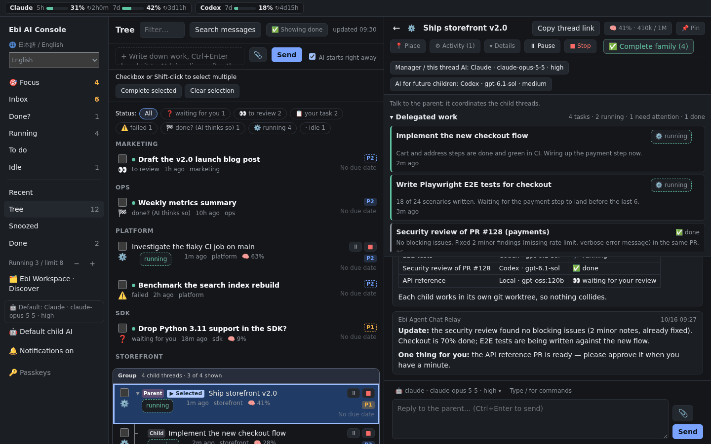
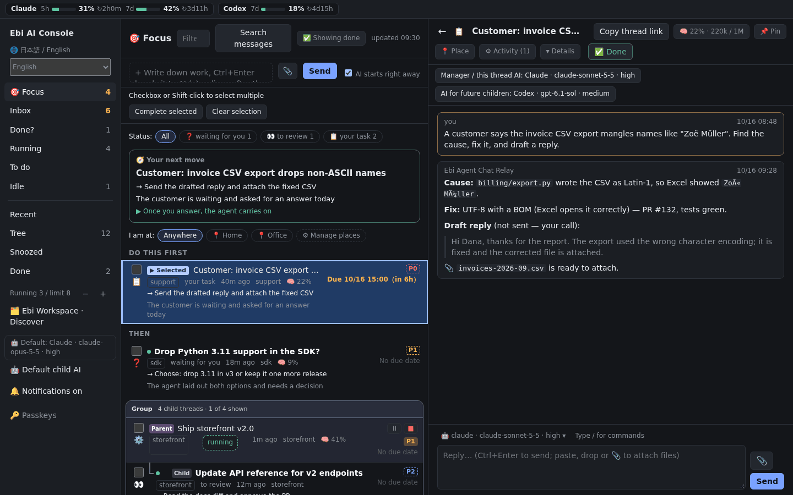

> 如有任何差异，以[英文版](../../README.md)为准。

# Ebi Agent Chat Relay

[](https://github.com/ebibibi/ebi-agent-chat-relay/actions/workflows/ci.yml)
[](https://github.com/ebibibi/ebi-agent-chat-relay/actions/workflows/codeql.yml)
[](https://www.python.org/downloads/)
[](https://github.com/ebibibi/ebi-agent-chat-relay/stargazers)
[](https://opensource.org/licenses/MIT)

**一个工作台，管理所有编码代理。** Claude Code、OpenAI Codex、本地模型、pi 和 AG-UI 代理可以并行工作；你可以通过桌面或手机上的专用 Web 控制台、Discord 或 Microsoft Teams 与它们交流。让能力更强的模型负责规划，把执行工作交给成本更低的模型，只在需要你判断时介入。

**[English](../../README.md)** | **[日本語](../ja/README.md)** | 简体中文 | **[한국어](../ko/README.md)** | **[Español](../es/README.md)** | **[Português](../pt-BR/README.md)** | **[Français](../fr/README.md)**



<sub>本 README 中的截图使用虚构示例数据。可运行 [`scripts/readme_screenshots.cjs`](../../scripts/readme_screenshots.cjs) 重新生成。</sub>

## 为什么使用它

| | |
|---|---|
| 🖥️ **专为代理监督打造的 GUI** | Ebi AI Console 将代理会话集中显示，并按当前轮到谁处理排序。你可以查看下一步、回复、附加文件、切换模型、暂停或停止，无需打开终端。 |
| 📱 **多个前端** | Discord、Microsoft Teams 和专用 Web 控制台可以单独或同时使用，共享同一个中继进程与会话。 |
| 🔀 **多个代理运行环境** | Claude Code、OpenAI Codex、本地模型、pi CLI 或 AG-UI 代理都可按会话选择，并在对话中切换。 |
| 💸 **兼顾成本的多代理协作** | 管理代理可把任务分给较便宜或固定费率的子代理；分流可使用可用的最低成本模型。 |
| 🛡️ **并行工作而不互相覆盖** | 每个会话使用独立 Git worktree，并能查看其他会话的工作和占用资源。 |

## 🖥️ Ebi AI Console — 监督代理，不必守着终端



同时运行多个代理并不难，难的是跟进它们。控制台首先回答“我现在该做什么”：Focus 视图汇总待你回复、待审查、失败、运行中和已完成的会话；你可以直接回复、查看附件、切换模型或控制运行。手机布局也支持查看代理、回答阻塞问题并继续工作。

控制台支持 passkey，以及可选的 Microsoft Entra ID、Google、OIDC、Cloudflare Access 和邮件 allowlist。它是可选前端；未设置 `CCDB_CONSOLE_PORT` 时不会启动监听。详见[控制台指南](../console.md)。

## 📱 多前端 — 在你常用的地方与代理交流

前端和代理运行环境彼此独立。一个进程可同时服务 Web 控制台、Discord 和 Teams，并共享会话、定时任务和 API。Teams 使用出站连接的会话主机；也可为控制台配置 Entra ID 或其他 OIDC 登录。参见 [Teams 设置](../teams-setup.md) 与[安全模型](../teams-relay.md)。

## 🔀 多运行环境 — 一个界面，多个代理 CLI

中继以子进程调用各代理的官方 CLI，因此每个代理继续使用自己的工具、技能、记忆和项目指令。可按会话切换后端；切换时会把对话交接给新代理继续处理。`local` 后端会检查 CLI 不会连接外部服务。详见[后端指南](../backends.md)、[本地后端](../local-backend.md)、[pi](../pi-backend.md) 与 [AG-UI](../agui-backend.md)。

## 💸 多代理并行，并兼顾成本

管理代理可拆解任务并分派给 Codex、较小的 Claude 模型或本地模型；每个子任务的状态和报告仍在控制台可见。Claude 与 Codex 配额分开，可将管理和执行分配给不同订阅。控制台分流、定时审计与摘要也可使用更小的模型。多个账号轮换见[账号池指南](../account-pools.md)。

## 🛡️ 安心并行会话

每个会话都是隔离且可恢复的代理工作区。中继会要求代理使用 Git worktree、登记活跃会话、在共享 AI Lounge 通报意图，并在触碰仓库、issue 或文件前申请资源占用。另有定时调度、CI 等待、启动恢复、REST API 和隔离执行环境。详见[功能指南](guide/features.md)。

## ⚡ 快速开始 — 两分钟启动控制台

无需 Discord 或 Teams。需要 Python 3.12+、[uv](https://docs.astral.sh/uv/) 和至少一个已登录的代理 CLI（如 `claude` 或 `codex`）。

```bash
git clone https://github.com/ebibibi/ebi-agent-chat-relay.git && cd ebi-agent-chat-relay
uv sync --extra console
mkdir -p data
printf 'CCDB_FRONTENDS=console\nAPI_PORT=8099\nCCDB_CONSOLE_PORT=8100\n' > .env
uv run ccdb start
```

打开 <http://localhost:8100>，输入日志中显示的一次性设置码，注册 passkey，然后创建第一个任务。想同时启用 Discord？运行 `uv run ccdb setup`。完整步骤见[快速开始指南](guide/getting-started.md)。

## 📚 文档

| 指南 | 内容 |
|---|---|
| [快速开始与配置](guide/getting-started.md) | Discord bot、设置向导、systemd、自定义 Cog、配置、权限模式和 Teams |
| [功能与会话协作](guide/features.md) | 并行会话、AI Lounge、资源占用、会话转发、摄取 API 与后端切换 |
| [功能参考](guide/reference.md) | 聊天、协作、定时任务、CI/CD、会话管理和安全功能 |
| [自动化、定时任务与 REST API](guide/automation.md) | GitHub Actions 示例、定时任务、自动升级和 REST API |
| [架构与背景](guide/architecture.md) | 架构设计、测试、本项目的构建方式 |
| [控制台](../console.md) · [后端](../backends.md) · [Teams 设置](../teams-setup.md) | 深入指南 |
| [安全](../SECURITY.md) · [执行环境](../execution-environments.md) · [ADR](../adr/) | 设计决策与安全信息 |

## 🤝 贡献 — 欢迎人类与代理

本项目由 AI 代理编写并由人类指导；人类和代理提交的 PR 都受欢迎。欢迎补充 README 和指南的中、韩、西、葡、法语翻译。开始前请阅读[贡献指南](../../CONTRIBUTING.md)。关于项目构建方式，见[架构指南](guide/architecture.md#本项目的构建方式)。

## 👤 作者

项目由 **Masahiko Ebisuda**（[@ebibibi](https://github.com/ebibibi)）创建。他是 Microsoft MVP，长期从事 Azure Hybrid 与 Windows Server 工作，并通过代理团队协作。

- YouTube：[胡田昌彦 / Windows、Azure、M365、生成式 AI](https://www.youtube.com/@ebibibi)
- 网站：[ebisuda.net](https://ebisuda.net)

## ⭐ Star 历史

如果这个中继为你节省了时间，欢迎给项目一个 Star，帮助更多人发现它。

[](https://star-history.com/#ebibibi/ebi-agent-chat-relay&Date)

*项目曾名 Claude Code Discord Bridge，后改为 Claude & Codex Discord Bridge，详见 [ADR-0001](../adr/0001-adopt-ebi-agent-chat-relay.md)。兼容标识仍为 `claude-code-discord-bridge` 包名和 `ccdb` 命令。发布记录：[v5.1.0](../releases/v5.1.0.md) · [v5.0.0](../releases/v5.0.0.md) · [v4.0.0](../releases/v4.0.0.md) · [CHANGELOG](../../CHANGELOG.md)。*

> **免责声明：** 本项目与 Anthropic 或 OpenAI 无关联，也未获其认可或官方支持。Claude、Claude Code、OpenAI、Codex 和 ChatGPT 均为各自公司的商标。本项目是独立的开源软件，通过 CLI 与相关服务交互。

---

## 许可证

MIT
